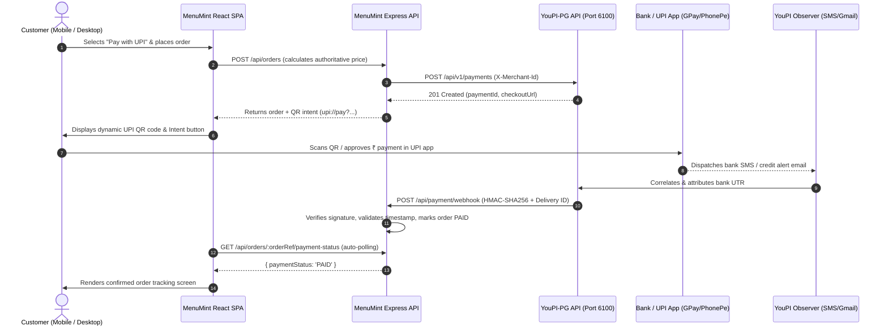
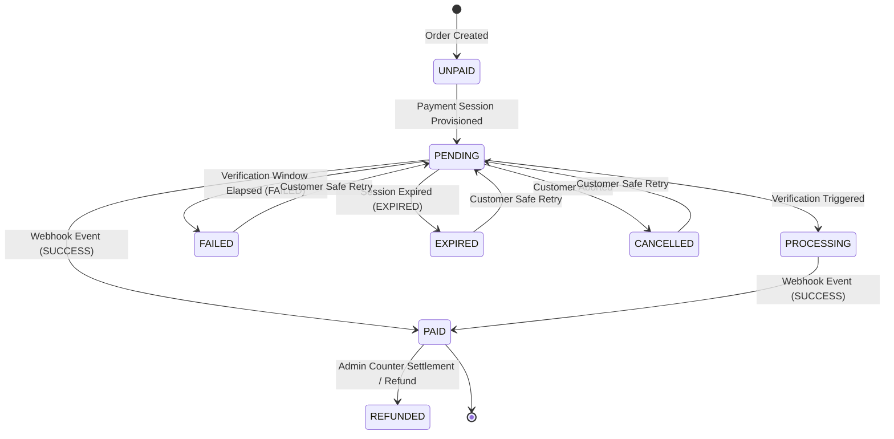

# MenuMint SaaS — YouPI-PG Payment Integration Guide

This document is the authoritative technical reference for the **YouPI-PG V2 UPI Payment Integration** implemented in MenuMint according to `docs/YOUPI_PG_PAYMENT_INTEGRATION_PROMPT.md`.

---

## 1. Architectural Overview

MenuMint integrates with **YouPI-PG V2** (decentralized zero-aggregator UPI gateway) as a separately deployed, microservice dependency. 



---

## 2. Environment Variables & Configuration

Configure the following variables in MenuMint server environment (see `.env.example`):

| Variable | Required | Default (Dev) | Description |
| :--- | :---: | :--- | :--- |
| `YOUPI_API_URL` | **Yes** | `http://localhost:6100` | Gateway backend REST API for creating payment sessions |
| `YOUPI_CHECKOUT_URL` | **Yes** | `http://localhost:7000` | Gateway customer-facing hosted checkout URL |
| `YOUPI_MERCHANT_ID` | **Yes** | `merch_menumint_001` | Merchant UUID assigned in YouPI Merchant Admin |
| `YOUPI_WEBHOOK_SECRET` | **Yes** | `youpi_sec_live_grind789` | HMAC-SHA256 signing secret for webhook verification |
| `YOUPI_UPI_ID` | Optional | `dailygrind@upi` | VPA address embedded into the UPI QR code |
| `YOUPI_PAYEE_NAME` | Optional | `The Daily Grind Cafe` | Merchant business name displayed inside customer UPI apps |
| `YOUPI_CURRENCY` | Optional | `INR` | UPI settlement currency |
| `APP_URL` | Optional | `http://localhost:3000` | Public base URL of MenuMint for payment return redirects |

> [!CAUTION]
> **Secret Hygiene:** Never prefix payment secrets with `VITE_` or `NEXT_PUBLIC_`. Payment secrets must never be exposed to browser bundles.

---

## 3. Payment State Machine & Invariants

MenuMint implements an explicit, unidirectional state machine for payment transitions:



### Critical Invariants:
1. **Downgrade Immunity:** Once an order is transitioned to `PAID`, delayed or out-of-order `FAILED`, `EXPIRED`, or `CANCELLED` webhook deliveries are automatically discarded without mutating the order.
2. **Server-Authoritative Pricing:** The browser never decides order totals, taxes, or discounts. The server recalculates totals from database item prices.
3. **Audit Trail:** Every payment state transition records a persistent entry containing `fromStatus`, `toStatus`, `timestamp`, `source`, `deliveryId`, and bank `utr`.

---

## 4. Webhook Security & Verification Contract

The webhook endpoint is mounted at:
`POST /api/payment/webhook` (and alias `POST /api/webhooks/payment`)

### Security Controls:
1. **Raw Body Hashing:** Webhook signatures are computed over the unparsed raw request buffer (`Buffer.from(req.rawBody)`).
2. **Constant-Time Comparison:** Verified with `crypto.timingSafeEqual` after length validation to prevent timing side-channel attacks.
3. **Timestamp Replay Guard:** The `X-Gateway-Timestamp` header is verified against server time. Requests with drift $> 5\text{ minutes}$ ($300,000\text{ ms}$) are rejected.
4. **Delivery Deduplication:** The `X-Gateway-Delivery-Id` header is cached in an idempotency ledger. Repeated deliveries return `200 OK` with `{ deduplicated: true }` without triggering duplicate side-effects.

---

## 5. Local Development Runbook

To run the complete stack locally:

### Step 1: Start YouPI-PG Gateway
```powershell
cd c:\Users\soumy\OneDrive\Desktop\youpi-pg
npm run dev
```
* Services running:
  * Control Center: `http://localhost:8090`
  * Merchant Admin: `http://localhost:6001`
  * Payment API: `http://localhost:6100`
  * Checkout Portal: `http://localhost:7000`
  * Gmail Observer: `http://localhost:6003`

### Step 2: Start MenuMint Application
```powershell
cd "c:\Users\soumy\OneDrive\Desktop\MENU & ORDERING SaaS"
npm run build
npm start
```
* MenuMint running at: `http://localhost:5000` (or `http://localhost:3000` via Vite dev).

---

## 6. Operational Limitations & Trust Boundaries

> [!WARNING]
> **Independent Settlement Reconciliation Notice:**
> YouPI-PG uses SMS and Gmail observers to monitor incoming UPI payment notifications. While dual-layer observer verification provides high correlation reliability, experimental notification observers do not replace official bank settlement statements.
> - For high-value transactions, verify credit alerts against net banking or merchant settlement summaries.
> - Staff counter settlement is available as an administrative override (`dashboardRouter.patch('/orders/:id/payment')`).

---

## 7. Troubleshooting & Rollback Plan

### Troubleshooting:
- **Webhook 401 Unauthorized:** Ensure `YOUPI_WEBHOOK_SECRET` matches the secret in YouPI Merchant Admin (`http://localhost:6001` → Developer Hub).
- **Payment Not Confirming:** Check Gmail Observer status at `http://localhost:6003`. If unlinked, click **[Connect Google Account](http://localhost:6003/connect)**.
- **Offline Gateway:** MenuMint automatically falls back to self-contained QR intent generation if the gateway API is momentarily unreachable.

### Rollback Plan:
If YouPI-PG must be disabled:
1. In café payment settings, toggle `paymentConfig.enabled = false` or switch the primary method to `CASH` / `CARD`.
2. Existing orders remain accessible; counter staff can settle any pending orders via Cash/Card settlement in the Staff Dashboard.

